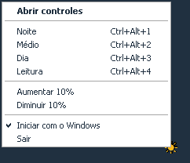

# ☀️ Controle de Brilho

Controle o brilho de **monitores externos no Windows** via **DDC/CI**, o mesmo canal usado pelos botões físicos do monitor. Ajuste cada tela com controles deslizantes ou use **atalhos globais** para níveis pré-definidos. O programa fica na **bandeja do sistema** e **inicia junto com o Windows**.

<p>
  
  &nbsp;&nbsp;
  
</p>

## Recursos

- 🖥️ Um controle deslizante por monitor, mais um controle **Todos**.
- ⌨️ Atalhos globais que funcionam em qualquer programa, mesmo com a janela fechada.
- 🎚️ Presets com um valor para todos os monitores ou um valor diferente para cada um.
- 🔔 Ícone na bandeja: o menu tem presets e opções, e a dica mostra o brilho atual de cada monitor.
- 🚀 Inicia minimizado com o Windows; dá para ligar ou desligar isso no menu, e não precisa de administrador.
- 📝 Configuração simples em `config.json`.
- 💻 Linha de comando: `--preset Noite`, `--definir 30 80`, `--listar`.

## Download e instalação

1. Baixe o **`ControleBrilho.zip`** da [**página de Releases**](https://github.com/jpnedes/controle-de-brilho/releases/latest).
2. Clique com o botão direito no arquivo → **Extrair Tudo…** → extraia em `C:\Programas`.
3. **Ative o DDC/CI no menu (OSD) de cada monitor.** Em muitos modelos ele vem desligado de fábrica.
4. Dê dois cliques em `C:\Programas\ControleBrilho\ControleBrilho.exe`.

O Windows SmartScreen pode mostrar o aviso *"O Windows protegeu o computador"*, porque o executável não é assinado digitalmente. Clique em **Mais informações → Executar assim mesmo**.

Na primeira execução, o programa cria o `config.json` ao lado do `.exe` e passa a iniciar com o Windows, já minimizado na bandeja.

**O ícone ficou escondido?** Clique na seta **^** ao lado do relógio e arraste o ☀️ para a barra de tarefas.

## Atalhos padrão

| Atalho          | Ação                          |
|-----------------|-------------------------------|
| `Ctrl+Alt+1`    | Noite: 10%                    |
| `Ctrl+Alt+2`    | Médio: 50%                    |
| `Ctrl+Alt+3`    | Dia: 100%                     |
| `Ctrl+Alt+4`    | Leitura: 40% / 60%            |
| `Ctrl+Alt+PgUp` | +10% em todos os monitores    |
| `Ctrl+Alt+PgDn` | −10% em todos os monitores    |

## Bandeja do sistema

- **Clique esquerdo** no ☀️ abre os controles deslizantes.
- **Clique direito** abre o menu: presets, aumentar ou diminuir, **Iniciar com o Windows** e **Sair**.
- Fechar a janela no **X** só a esconde; os atalhos continuam ativos. Para encerrar de verdade, use **Sair**.
- Abrir o `.exe` de novo com o programa já rodando apenas mostra a janela, sem criar uma segunda cópia.

## Configuração

Edite o `config.json`, que fica na mesma pasta do `.exe`. Depois use **Sair** no menu da bandeja e abra o programa de novo.

```json
{
  "iniciar_com_windows": true,
  "passo": 10,
  "nomes_monitores": ["Esquerda", "Direita"],
  "atalhos": {
    "aumentar": "<ctrl>+<alt>+<page_up>",
    "diminuir": "<ctrl>+<alt>+<page_down>"
  },
  "presets": [
    {"nome": "Noite",   "atalho": "<ctrl>+<alt>+1", "brilho": 10},
    {"nome": "Médio",   "atalho": "<ctrl>+<alt>+2", "brilho": 50},
    {"nome": "Dia",     "atalho": "<ctrl>+<alt>+3", "brilho": 100},
    {"nome": "Leitura", "atalho": "<ctrl>+<alt>+4", "brilho": [40, 60]}
  ]
}
```

| Opção                 | Descrição |
|-----------------------|-----------|
| `iniciar_com_windows` | `true` ou `false`. Também pode ser alterado pelo menu da bandeja. |
| `passo`               | Quanto os atalhos de aumentar e diminuir mudam, em %. |
| `nomes_monitores`     | Nomes exibidos na janela, na ordem de `--listar`. |
| `brilho`              | Um **número** vale para todos os monitores. Uma **lista** define um valor por monitor; use `null` para não alterar aquele monitor. |
| `atalho`              | Formato do [pynput](https://pynput.readthedocs.io/en/latest/keyboard.html#global-hotkeys): `<ctrl>`, `<alt>`, `<shift>`, `<cmd>` (a tecla Windows), `<f1>`…`<f12>`, `<page_up>`, letras e números. |

## Linha de comando

```bash
ControleBrilho.exe                  # bandeja + janela + atalhos
ControleBrilho.exe --minimizado     # só a bandeja (é assim que inicia com o Windows)
ControleBrilho.exe --preset Noite   # aplica um preset e sai
ControleBrilho.exe --definir 50     # 50% em todos os monitores
ControleBrilho.exe --definir 30 80  # 30% no monitor 1, 80% no monitor 2
ControleBrilho.exe --listar         # mostra os monitores e o brilho atual
ControleBrilho.exe --simular        # testa a interface sem mexer nos monitores
```

## Problemas comuns

- **"Nenhum monitor com DDC/CI encontrado"**: o DDC/CI está desligado no OSD do monitor, ou o cabo, dock ou adaptador não repassa os comandos. Docks USB-C e adaptadores DisplayLink costumam bloquear; a conexão direta por **HDMI** ou **DisplayPort** é a mais confiável.
- **Só um monitor muda**: o outro provavelmente está com o DDC/CI desligado.
- **Um atalho não funciona**: outro programa pode estar usando a mesma combinação. Troque-a no `config.json`.
- **A tela do notebook não aparece**: é esperado, porque telas internas não usam DDC/CI.
- **Erro logo ao ligar o PC**: alguns monitores demoram a responder após o boot. Ao iniciar com o Windows, o programa tenta de novo por cerca de 1 minuto antes de avisar.

## Desinstalar

Clique com o botão direito no ☀️, desmarque **Iniciar com o Windows** e clique em **Sair**. Depois apague a pasta do programa.

## Rodar pelo código-fonte

Requer Python 3.10 ou mais recente.

```bash
pip install -r requirements.txt
python brilho.py
```

Para gerar o `.exe`, execute o **`build.bat`** no Windows. O arquivo é criado em `dist\ControleBrilho.exe`.

O código também funciona no **Linux** (X11). Nesse caso:
- carregue o módulo `i2c-dev` (`sudo modprobe i2c-dev`) e dê ao seu usuário acesso a `/dev/i2c-*` (grupo `i2c`);
- o ícone na bandeja requer GTK/AppIndicator;
- no Wayland, os atalhos globais não funcionam; crie atalhos no próprio ambiente gráfico chamando `python3 brilho.py --preset Noite`.

## Tecnologias

[monitorcontrol](https://github.com/newAM/monitorcontrol) (DDC/CI) · [pynput](https://github.com/moses-palmer/pynput) (atalhos globais) · [pystray](https://github.com/moses-palmer/pystray) (bandeja) · tkinter (interface) · [PyInstaller](https://pyinstaller.org) (executável)
